# Truvify — does your citation actually support your claim?

**Truvify checks every cited sentence in a paper against the source it cites.** Upload a PDF, Word, Excel or PowerPoint file and get a trust score, the evidence quote behind each verdict, alerts for fabricated, retracted and outdated references, and one-click corrections you can re-verify and download.

React 18 · TypeScript · Vite · Tailwind CSS · Supabase (Auth, Postgres + RLS, Storage, Edge Functions) · Crossref · OpenAlex · Google Gemini

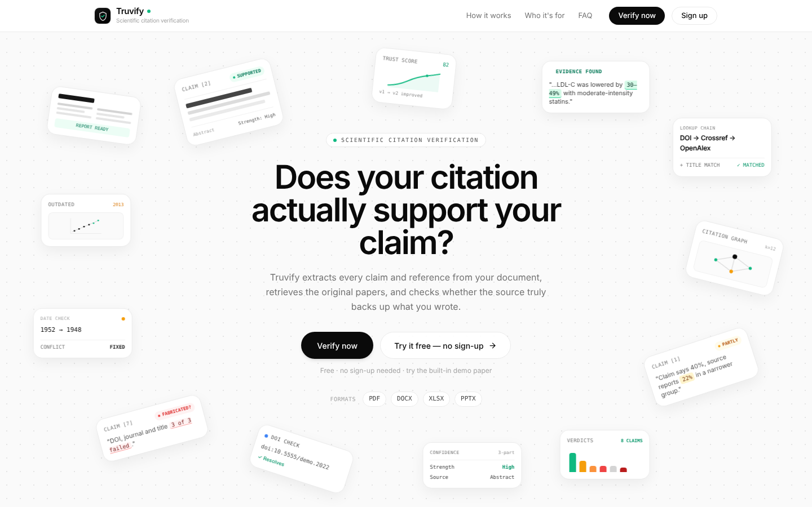

---

## Try it in 60 seconds

1. Open the app and click **Try it free — no sign-up** (or **Continue as Guest** on `/login`).
2. On the upload page click **Load Demo Paper (.pdf)**, then **Start verification**.
3. Read the report: trust score, verdicts, evidence quotes, a made-up reference flagged as *Likely fabricated*, a wrong year (1952 → 1948) with a suggested fix.
4. Click **Auto-correct**, approve the fixes, and **Download corrected file**.

Guest mode needs no account and runs entirely in your browser, even on the live site.

Run it locally:

```bash
npm install
npm run dev          # http://localhost:5173
```

---

## 1. The problem

A citation is a promise that the source says what the sentence says. That promise is often broken, and checking it by hand means opening every source.

| Finding | Source |
|---|---|
| About **1 in 4** citations in medical journal articles contain a quotation error (the source doesn't support the statement); about 12% are major errors. | Jergas & Baethge, *PeerJ* 2015 — meta-analysis of 28 studies, 7,321 references. [peerj.com/articles/1364](https://peerj.com/articles/1364) |
| **55%** of references written by ChatGPT-3.5 in short literature reviews did not exist; GPT-4 still invented 18%. | Walters & Wilder, *Scientific Reports* 2023. [doi:10.1038/s41598-023-41032-5](https://doi.org/10.1038/s41598-023-41032-5) |
| An updated review of 46 studies (~32,000 quotations) found **no improvement** in quotation accuracy over time. | Baethge & Jergas, *Research Integrity and Peer Review* 2025. [kups.ub.uni-koeln.de/80931](https://kups.ub.uni-koeln.de/80931/) |

## 2. What's new — an evidence check, not a formatter

| | Truvify | Reference manager | Plagiarism checker | General AI chatbot |
|---|:-:|:-:|:-:|:-:|
| Confirms each reference exists (DOI + title lookup) | ✅ | partly | — | — |
| Checks the cited paper supports the sentence | ✅ | — | — | partly |
| Shows the exact evidence quote and the reason | ✅ | — | — | — |
| Catches wrong numbers, years and overstated wording | ✅ | — | — | partly |
| Flags retracted, corrected and outdated sources | ✅ | partly | — | — |
| Suggests a safe fix, re-verifies it, exports the corrected file | ✅ | — | — | partly |
| Detects copied text | — | — | ✅ | — |

Truvify works *alongside* those tools and fills the gap between them.

## 3. Features

- **Six verdicts** — Supported, Partly supported, Unsupported, Contradicted, Not found, Likely fabricated — each with the evidence quote, the reason, evidence strength and source used.
- **Trust score** — `round((supported + 0.5 × partly) / total × 100)`, shown as Green (70–100), Amber (40–69) or Red (0–39).
- **Fabricated-reference detection** — a DOI that doesn't resolve *and* a title that can't be found → *Likely fabricated*. Unreachable databases are never reported as fabricated.
- **Date conflicts, wrong numbers, negation and overstated wording** (“eliminates”, “proves”).
- **Retraction / correction notices** and **outdated-source alerts** with a newer, well-cited paper when one exists. Each domain has its own age rule (Medical 7 years, General 10, Geological and Student 12, never for Historical and Legal).
- **Auto-correct with permission** — approve each fix, re-verify only the changed sentences, download the corrected file in its original format.
- **Highlight view** — the whole document colour-coded by verdict, with in-place editing.
- **Ask about this report** — grounded Gemini chat (signed-in users) limited to the report's own facts; “Claim N” links jump to the claim.
- **Exports** — PDF, Word, Excel and PowerPoint reports.
- **Dashboard and Compare** — history, file preview, and side-by-side comparison of two versions.
- **Automatic domain detection** from the first 1,000 words.

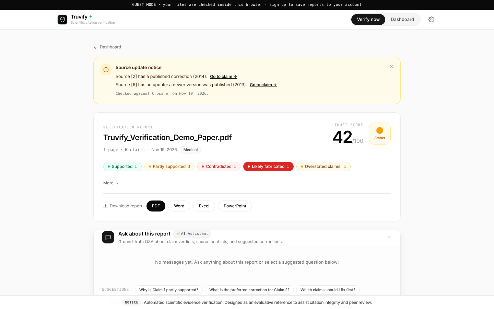

## 4. Who benefits

Students and teachers, researchers, journal editors and peer reviewers, clinicians and guideline writers, journalists and fact-checkers, and policy and legal writers. It runs in any modern browser, works in every field, and uses free, open scholarly databases, so cost is never a barrier.

## 5. How it works

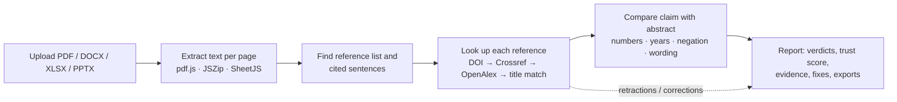

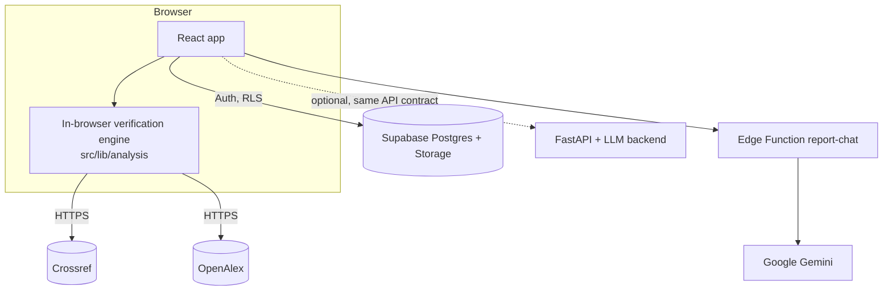

| Mode | When | What runs where |
|---|---|---|
| **Guest / demo** | “Try it free”, or empty Supabase keys | Everything in the browser; results in `localStorage`, files in IndexedDB |
| **Browser (default live)** | `VITE_BACKEND_MODE=browser` | Verification in the browser; documents, claims and files saved to Supabase with row-level security |
| **FastAPI** | `VITE_BACKEND_MODE=fastapi` | Heavy work on a server that follows [`BACKEND_CONTRACT.md`](BACKEND_CONTRACT.md) |

## 6. Technical highlights

- **Strict TypeScript** (`strict`, `noUnusedLocals`, `noUnusedParameters`); type check and production build pass with no warnings.
- **Code splitting** — app pages load on demand and the export libraries (docx, jsPDF, pptxgenjs, SheetJS) load only on the report page. The landing page downloads about 210 KB (gzip) instead of about 700 KB.
- **Security** — Supabase Auth, Postgres row-level security on every table, private per-user storage, Edge Functions that check the session and ownership, rate limits (30 chat messages per hour).
- **Accessibility** — skip link, visible keyboard focus, `aria` labels and current-page markers, honours *reduce motion*, semantic tables and headings.
- **Progressive animation** — content is visible by default and only animates in as the visitor scrolls, so screenshots, printing and crawlers never see blank sections.
- **SEO and sharing** — description, Open Graph and Twitter cards with a preview image, structured data, `noscript` fallback.
- **Hosting ready** — SPA fallbacks for Vercel (`vercel.json`) and Netlify (`public/_redirects`).

## 7. Scalability and roadmap

- **Serverless engine** — checking happens in each visitor's browser, so more users add no server load.
- **Swappable backend** — one setting moves the comparison step to a FastAPI + LLM service with the same API contract.
- **Multi-user cloud** — Supabase Auth, RLS, private storage and Edge Functions scale per account.

Planned next (not built yet): full-text checking of open-access papers · LLM claim comparison on the server backend · superscript citation numbers · Word and Google Docs add-ins · team workspaces for journals and universities · public API for publishers.

## 8. Tests

Browser tests use Python + Playwright with canned Crossref/OpenAlex responses (`tests/fake_db.py`), so they run offline.

```bash
pip install playwright reportlab python-docx python-pptx openpyxl && playwright install chromium
npm run dev                          # in another terminal
python tests/e2e_guest.py            # first-visit guest journey + phone layout (29 checks)
python tests/e2e_results.py          # report features and exports (20 checks)
python tests/e2e_app.py              # landing, dashboard, compare, settings, failure cases (12 checks)
python tests/e2e_formats.py          # DOCX / PPTX / XLSX / scanned PDF
```

`BASE=http://localhost:4173 python tests/e2e_guest.py` runs the guest journey against a production build (`npm run build && npm run preview`).

## Screenshots

| | |
|---|---|
| 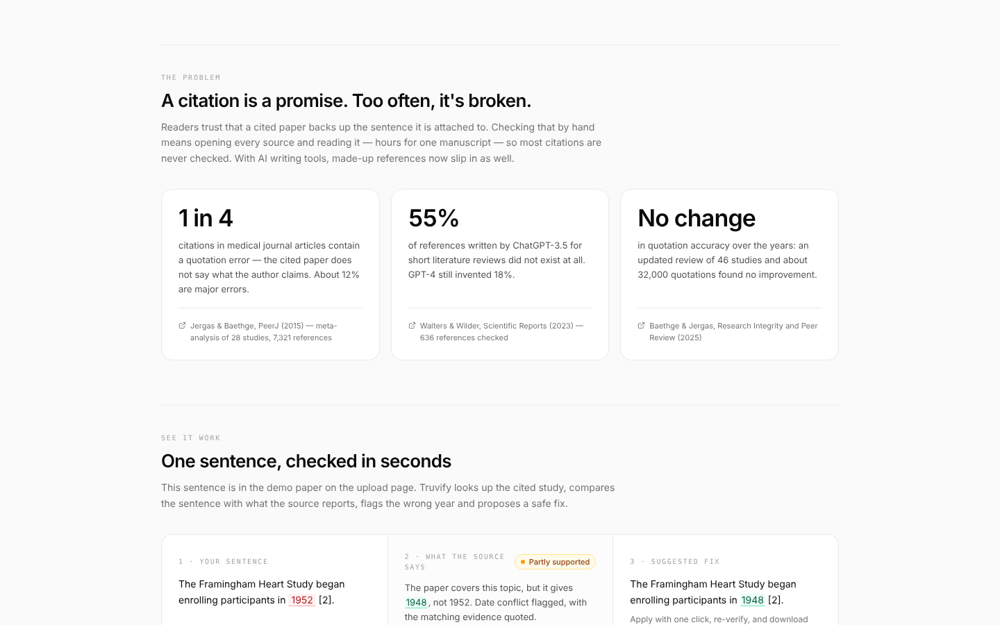 | 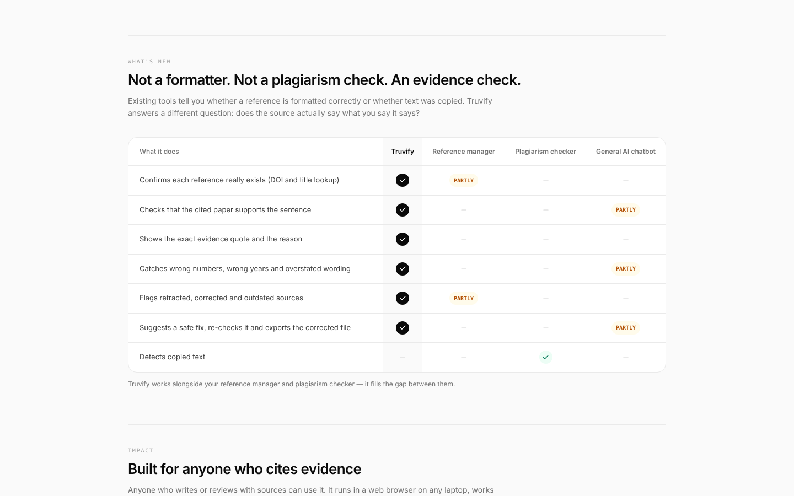 |
| 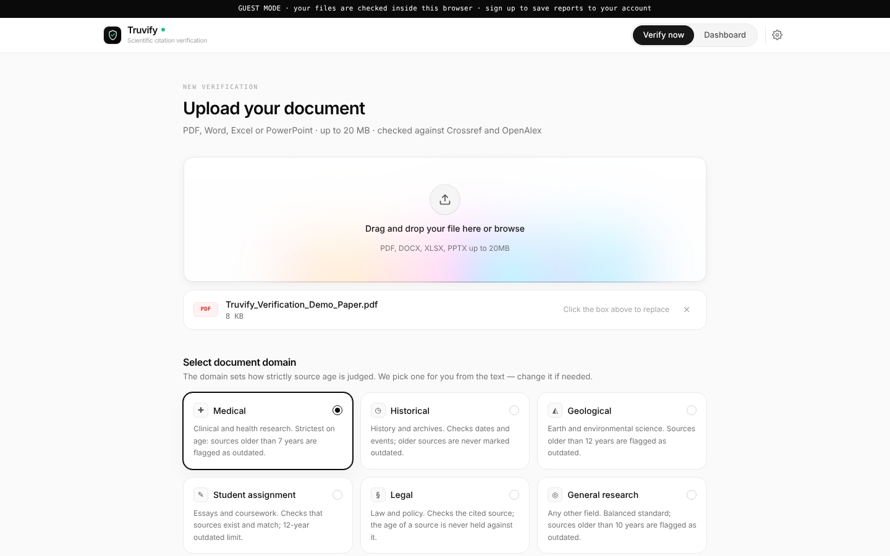 | 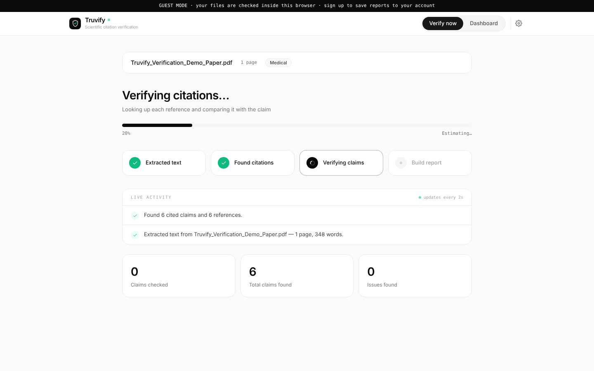 |
| 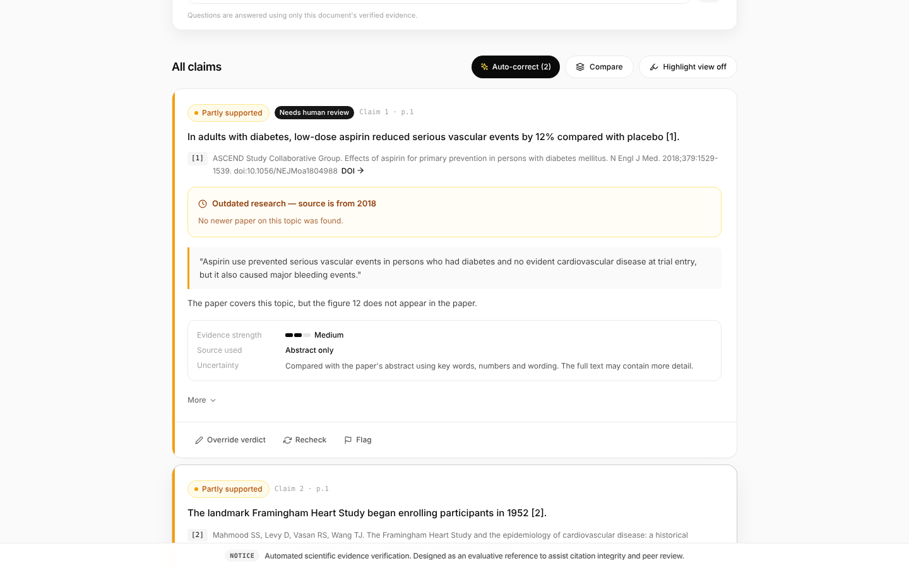 | 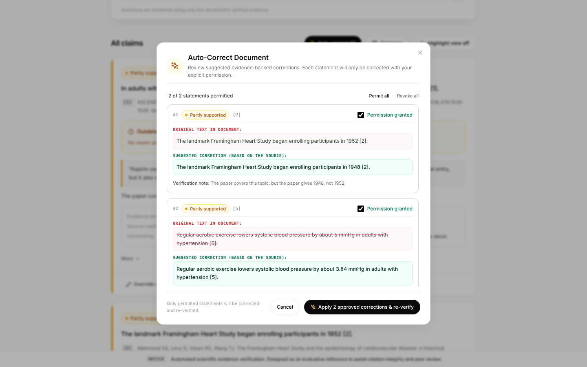 |
| 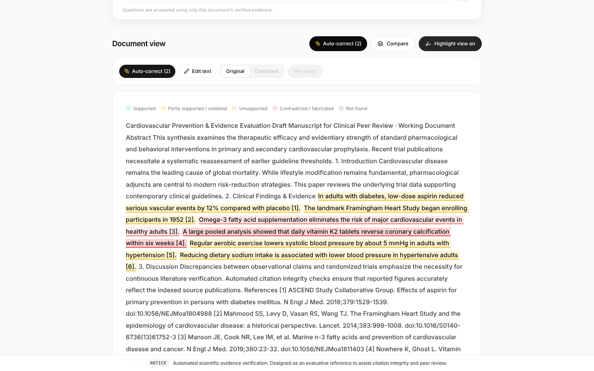 | 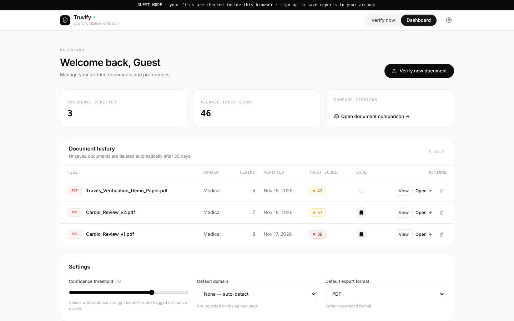 |

## Known limits

- Claims are compared with the source's **abstract**, not the full paper, using transparent rules (not an LLM) in browser mode.
- Superscript citation numbers (¹ ²) and scanned PDFs without a text layer aren't supported yet.
- Up to 60 claims per document. Lookups need internet access to Crossref and OpenAlex.

## Go live (Supabase + Gemini AI)

Truvify runs completely serverless with **Supabase + in-browser verification + Supabase Edge Functions** (no FastAPI backend required when `VITE_BACKEND_MODE=browser`):

1. **Database & Storage**: In your Supabase Dashboard &rarr; **SQL Editor**, run the script in `supabase/schema.sql`. This sets up tables (`documents`, `claims`, `chat_messages`), RLS policies, storage bucket (`documents`), and permissions.
2. **Authentication**:
   - Go to **Authentication &rarr; Providers &rarr; Email**: ensure Email provider is enabled and **"Confirm email" is turned ON**.
   - Go to **Authentication &rarr; URL Configuration**:
     - Set **Site URL** to `http://localhost:5173` (or your production domain).
     - Add `http://localhost:5173/**` to **Redirect URLs**.
   - *Note on email limits:* Supabase's built-in email service is rate-limited to only a few emails per hour. For production users, configure custom SMTP under **Authentication &rarr; SMTP Settings**.
3. **Set Secrets and Deploy Edge Functions**:
   ```bash
   npx supabase login
   npx supabase link --project-ref zofxajcllnltzbrpdrfe
   npx supabase secrets set GEMINI_API_KEY=<PASTE_GEMINI_KEY_HERE> GEMINI_MODEL=gemini-2.5-flash
   npx supabase functions deploy report-chat
   npx supabase functions deploy delete-account
   ```
4. **Environment Variables**: Update `.env`:
   ```env
   VITE_SUPABASE_URL=https://zofxajcllnltzbrpdrfe.supabase.co
   VITE_SUPABASE_ANON_KEY=sb_publishable_am8Jb09Jte25O7RQoMeL3Q_aufLz35R
   VITE_DEMO_MODE=false
   VITE_BACKEND_MODE=browser
   VITE_API_URL=http://localhost:8000
   VITE_DEMO_EMAIL=
   VITE_DEMO_PASSWORD=
   ```
5. **Start the app**:
   ```bash
   npm run dev
   ```

## Pages

| Route | Page |
|---|---|
| `/` | Landing: problem, worked example, how it works, comparison, who it's for, architecture, privacy, FAQ |
| `/login`, `/signup`, `/verify-email`, `/reset-password` | Auth (email + password, guest session, password reset) |
| `/upload` | File upload, demo papers, domain selection with auto-detect |
| `/progress/:jobId` | Live progress (polls every 2 s) |
| `/results/:documentId` | Report: trust score, AI report chat, claim cards, highlight view, auto-correct, re-verify, exports |
| `/compare` | Compare two document versions |
| `/dashboard` | History, original file preview, preferences |

## Structure

```
src/
  lib/          types, config, api, liveBrowser (live mode), mock (guest/demo mode), verdicts, export
  lib/analysis/ in-browser engine: extract, citations, sources (Crossref/OpenAlex), judge, pipeline
  context/      AuthContext, ToastContext
  components/   Navbar, ClaimCard, ReportChat, LandingSections, shared UI, icons
  pages/        Landing, AuthPages, Upload, Progress, Results, Compare, Dashboard
supabase/
  schema.sql            Idempotent SQL schema with RLS and Storage policies
  config.toml           Supabase Edge Functions configuration
  functions/
    report-chat/        Deno function proxying Gemini with grounded context
    delete-account/     Deno function cleaning storage, user rows and the auth account
tests/          Playwright end-to-end tests and fixture builder
docs/screenshots/
```
